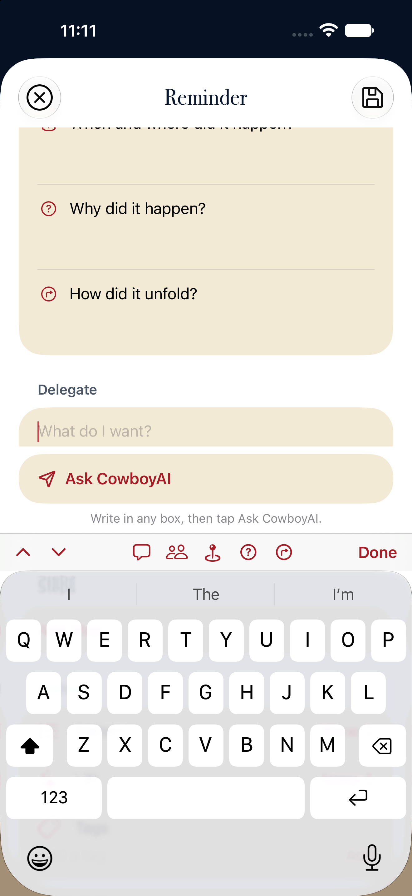
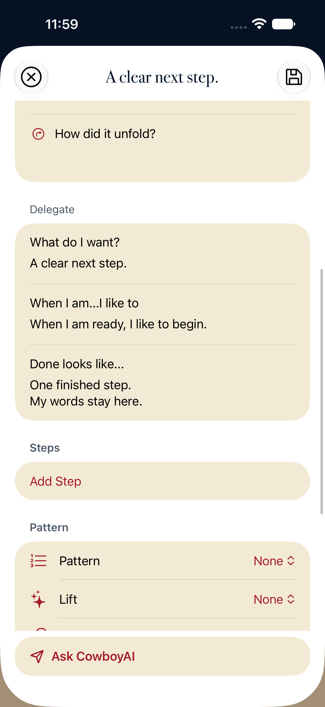
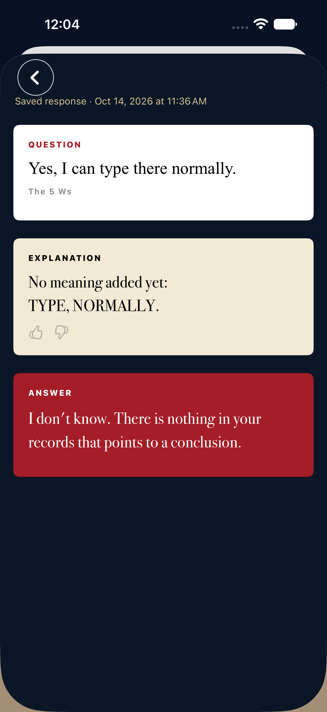

# SAVY preserved; separate CowboyAI simulator trial

The original SAVY source, installed app and local records are unchanged. The trial starts with the actual SAVY app source and uses its native forms, navigation, carousel and gesture controls.

## Preservation

- Backup: `/Users/adamblair/Documents/SAVY-preservation/2026-10-14-102128/`.
- Full source checkout, Git history, nested worktrees and unfinished/untracked work; installed `/Applications/SAVY.app`; complete local Mac container.
- 266,433 files and links matched. 25,844,229,412 regular-file bytes preserved. Portable Git bundle verified.
- A second full comparison after the trial work found zero differences. See `original-recheck.json`.
- The physical phone was not accessed. No SAVY cloud data was modified.

## Trial

Open `ios-savy/CowboyAITrial.xcodeproj`, scheme `CowboyAITrial`, on simulator `CowboyAI-Recovery` (`D2BC1BBD-8375-4225-A9BE-F50C1D65E023`). The app is installed there as **CowboyAI Trial**, bundle `com.adamblair.cowboyai.savytrial`.

The FAB retains Reminder, Action, Post and Calendar. Each opens SAVY's complete shared entry form. Ask CowboyAI is added above the keyboard controls; it sends the exact authored writing and theme fields to the existing Nucleus engine at `http://127.0.0.1:8766`. The engine was not changed.

Home uses the native SAVY carousel and colored cards, without a Recent responses heading. Right swipe exposes Pin/Unpin and Edit. Pins are independent, reorder with the original SAVY controls, retain their exact response snapshot, and survive relaunch. The rejected Pin/Details/Create toolbar is absent.

Ask returns to the same writing. Saved entries retain their response origin. Recovery preserves unsent writing after connection failure and app termination. The trial has its own app container and keychain service. SAVY/AWS, CloudKit and Harness writes are disabled at their service boundaries; SAVY authentication packages and credentials are not included in the trial build.

**This work stays local.** The parent Nucleus repository has a public origin. SAVY source, bundled personal material and these screenshots are not authorized for publication there.

## Verification

- Final model/persistence regression run: **64 passed, 0 failed**. Includes all 9 integration checks and 55 existing SAVY theme, recovery, pin-order, reorder and connection-store checks.
- All **6 selected UI flows passed** across the simulator runs: all four FAB choices; independent response pin/unpin and relaunch; original Home-card pin order; original Post entry/save/reopen; failed Ask draft recovery; real FLOW Ask, source-word inspection, save and linked-answer reopening.
- The first run found an environment missing from the recovery sheet, lost subsecond origin timestamps, and an ambiguous test locator. These were repaired and the failing checks passed on rerun. Assertions were retained or strengthened.
- Manual visual inspection used Device Hub's actual CowboyAI-Recovery simulator: normal Home with saved history, carousel, response colors, FAB fan and Post form. Test attachments were also opened and inspected, including exposed swipe actions, multiple pins, exact draft recovery and the live answer.

Result bundles are under `/Users/adamblair/Library/Developer/XcodeBuildMCP/workspaces/Cowboyai-89a3407fd2e7/result-bundles/`:

- `test_sim_2026-10-14T17-55-38-393Z_pid34973_dd0ef4b2.xcresult`: final 64 passing model/persistence checks.
- `test_sim_2026-10-14T17-50-40-110Z_pid34973_126b053a.xcresult`: 11 passing integration/recovery/live-Ask checks.
- `test_sim_2026-10-14T17-43-33-641Z_pid34973_8e4f6846.xcresult`: initial regression run, including the four other passing UI flows and the subsequently repaired failures.

## Actual simulator captures

The attachment manifests in `attachments-first-pass/` and `attachments-retest/` identify each captured state and its simulator test.

## Empty Ask interaction, October 14 follow-up

Reproduced on the actual recovery simulator: the added Ask button was disabled whenever the entry contained only empty template prompts. The rest of the form accepted input, but clicking Ask produced no response.

Ask now remains active on an empty entry. Clicking it focuses and reveals the original “What do I want?” field and explains that writing in any box can be sent with Ask. It does not submit the untouched prompts. Once writing exists, the same button sends it through the unchanged engine. Saving and an in-progress request still prevent duplicate submission.

Verification: 3 UI flows passed, 0 failed. The live flow now starts by clicking empty Ask, verifies the keyboard and focused visible field, types directly without tapping another control, receives the FLOW answer, inspects the exact dictionary words, returns to the same entry, saves, relaunches and reopens the saved response. The other flows cover all four original FAB choices and connection-failure recovery.

Result: `test_sim_2026-10-14T18-08-09-242Z_pid34973_9949868e.xcresult` in the result-bundle directory above. Screenshots and their manifest are in `attachments-ask-interaction/`.

After the tests, relaunched without fixture arguments, manually clicked Ask on the recovered blank entry, and visually confirmed the cursor in the revealed writing field. Left that active form open for Adam. Original SAVY source remains at `87f2b8c535fd7069d9748159a78d3770247f1a2c` with its same two untracked paths; no original app/data or physical-device access occurred.

## Approved delegation and Explanation changes, October 14 follow-up

The Delegate section is one SAVY light brown component with regular-weight questions, an answer field below each question, and the existing internal separators. The questions remain visible during typing and after recovery. The submitted text now includes `What do I want?` above the title answer, matching the question labels already carried for the other two delegation answers. User-authored spaces and newlines remain exact. The response link is retained with Adam's approved label, `Original CowboyAI response`.

Explanation uses the existing `Brand.card` light brown with dark text and feedback controls. The normal form and legacy explanation renderer receive this same palette. Answer styling and the Ask button are unchanged by this follow-up. No original SAVY, phone, engine, meaning or graph changes were made.

Verification:

- Three exact-payload/template model tests passed.
- The live empty-Ask/type/answer/return/save/relaunch/origin-reopen UI test passed.
- The new all-three-delegation-fields typing/relaunch recovery UI test passed. Its first run exposed a test scrolling overshoot; the helper was corrected to scroll toward the field with a bounded stroke. Every assertion was retained.
- Opened and visually inspected the actual simulator screenshots, including all three recovered answers in one regular-weight Delegate component.
- Built the Explanation palette change successfully, launched the normal app without fixture arguments, and opened the existing original-response link through Device Hub. Visually confirmed the light brown Explanation with dark text, separate from the existing Answer panel. The initial Xcode semantic tap did not navigate; the native Device Hub button click did, and the resulting screen was captured. No application code was changed for this automation issue.
- Left the saved response visible on CowboyAI-Recovery, preserving the user's underlying draft.

Result bundles (same directory listed above):

- `test_sim_2026-10-14T18-55-25-850Z_pid34973_62ea30f4.xcresult`: 3 model checks and live Ask flow passed; original scrolling-helper failure recorded.
- `test_sim_2026-10-14T18-58-35-635Z_pid34973_ca7567c2.xcresult`: all-three-field recovery passed, 0 failures.
- Build log: `build_run_sim_2026-10-14T19-03-15-118Z_pid34973_8414959b.log`.

