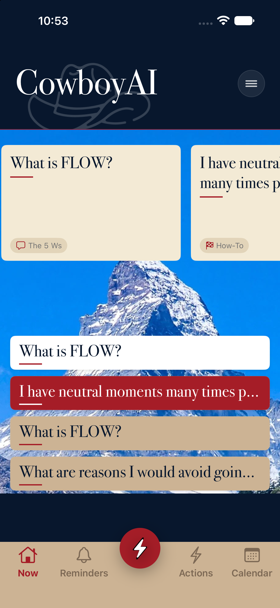
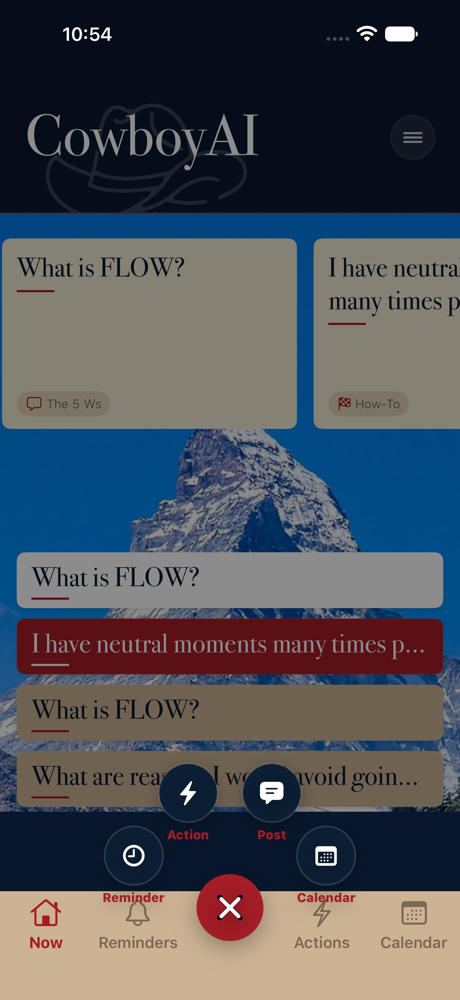
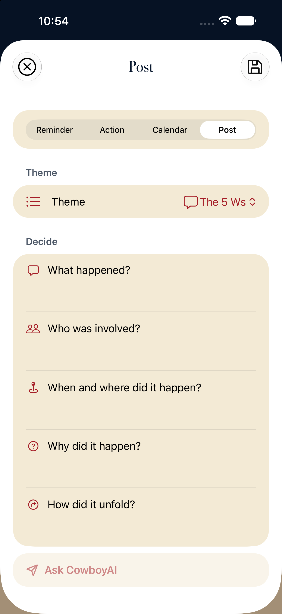

# SAVY preserved; separate CowboyAI simulator trial

The original SAVY source, installed app and local records are unchanged. The trial starts with the actual SAVY app source and uses its native forms, navigation, carousel and gesture controls.

## Preservation

- Backup: `/Users/adamblair/Documents/SAVY-preservation/2026-10-14-102128/`.
- Full source checkout, Git history, nested worktrees and unfinished/untracked work; installed `/Applications/SAVY.app`; complete local Mac container.
- 266,433 files and links matched. 25,844,229,412 regular-file bytes preserved. Portable Git bundle verified.
- A second full comparison after the trial work found zero differences. See `original-recheck.json`.
- The physical phone was not accessed. No SAVY cloud data was modified.

## Trial

Open `ios-savy/CowboyAITrial.xcodeproj`, scheme `CowboyAITrial`, on simulator `CowboyAI-Recovery` (`D2BC1BBD-8375-4225-A9BE-F50C1D65E023`). The app is installed there as **CowboyAI Trial**, bundle `com.adamblair.cowboyai.savytrial`.

The FAB retains Reminder, Action, Post and Calendar. Each opens SAVY's complete shared entry form. Ask CowboyAI is added above the keyboard controls; it sends the exact authored writing and theme fields to the existing Nucleus engine at `http://127.0.0.1:8766`. The engine was not changed.

Home uses the native SAVY carousel and colored cards, without a Recent responses heading. Right swipe exposes Pin/Unpin and Edit. Pins are independent, reorder with the original SAVY controls, retain their exact response snapshot, and survive relaunch. The rejected Pin/Details/Create toolbar is absent.

Ask returns to the same writing. Saved entries retain their response origin. Recovery preserves unsent writing after connection failure and app termination. The trial has its own app container and keychain service. SAVY/AWS, CloudKit and Harness writes are disabled at their service boundaries; SAVY authentication packages and credentials are not included in the trial build.

**This work stays local.** The parent Nucleus repository has a public origin. SAVY source, bundled personal material and these screenshots are not authorized for publication there.

## Verification

- Final model/persistence regression run: **64 passed, 0 failed**. Includes all 9 integration checks and 55 existing SAVY theme, recovery, pin-order, reorder and connection-store checks.
- All **6 selected UI flows passed** across the simulator runs: all four FAB choices; independent response pin/unpin and relaunch; original Home-card pin order; original Post entry/save/reopen; failed Ask draft recovery; real FLOW Ask, source-word inspection, save and linked-answer reopening.
- The first run found an environment missing from the recovery sheet, lost subsecond origin timestamps, and an ambiguous test locator. These were repaired and the failing checks passed on rerun. Assertions were retained or strengthened.
- Manual visual inspection used Device Hub's actual CowboyAI-Recovery simulator: normal Home with saved history, carousel, response colors, FAB fan and Post form. Test attachments were also opened and inspected, including exposed swipe actions, multiple pins, exact draft recovery and the live answer.

Result bundles are under `/Users/adamblair/Library/Developer/XcodeBuildMCP/workspaces/Cowboyai-89a3407fd2e7/result-bundles/`:

- `test_sim_2026-10-14T17-55-38-393Z_pid34973_dd0ef4b2.xcresult`: final 64 passing model/persistence checks.
- `test_sim_2026-10-14T17-50-40-110Z_pid34973_126b053a.xcresult`: 11 passing integration/recovery/live-Ask checks.
- `test_sim_2026-10-14T17-43-33-641Z_pid34973_8e4f6846.xcresult`: initial regression run, including the four other passing UI flows and the subsequently repaired failures.

## Actual simulator captures

The attachment manifests in `attachments-first-pass/` and `attachments-retest/` identify each captured state and its simulator test.
